# Pagamentos Recorrentes — Diagramas

> Documento complementario de [`recurring-payments.md`](./recurring-payments.md).
> Todos los diagramas distinguen **CURRENT** (implementado) de **TARGET** (a implementar) donde difieren.

## Índice

1. [Diagrama de decisión principal](#1-diagrama-de-decisión-principal)
2. [Diagramas de secuencia](#2-diagramas-de-secuencia)
   - [2.1 FIXED manual](#21-secuencia-1-fixed-manual)
   - [2.2 VARIABLE manual](#22-secuencia-2-variable-manual)
   - [2.3 FIXED + saved PIX](#23-secuencia-3-fixed-saved-pix)
   - [2.4 FIXED + PIX informado](#24-secuencia-4-fixed-pix-informado)
   - [2.5 VARIABLE + PIX](#25-secuencia-5-variable-pix)
   - [2.6 VARIABLE + BILL](#26-secuencia-6-variable-bill)
   - [2.7 Banking webhook success](#27-secuencia-7-banking-webhook-success)
   - [2.8 Banking failure](#28-secuencia-8-banking-failure)
   - [2.9 BLOCKED](#29-secuencia-9-blocked)
   - [2.10 Retry](#210-secuencia-10-retry)
3. [Diagrama de estados](#3-diagrama-de-estados)
4. [Diagrama de modelo de datos](#4-diagrama-de-modelo-de-datos)
5. [Diagrama de idempotencia](#5-diagrama-de-idempotencia)

---

## 1. Diagrama de decisión principal

**Este es el diagrama central de la documentación.**

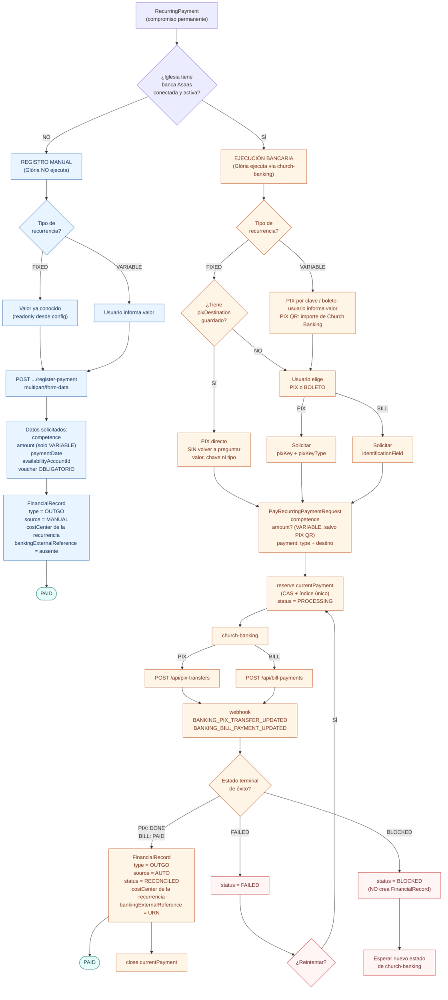

### 1.1 Lectura de las reglas del árbol

| Decisión | Determina | NO determina |
|---|---|---|
| ¿Asaas conectado? | **Quién ejecuta** (Glória o el usuario) | El método de pago |
| `FIXED` / `VARIABLE` | **Qué datos** se piden (valor readonly o input) | Quién ejecuta |
| `pixDestination` presente | **Si se puede saltar** la pregunta de destino PIX | Que el método sea PIX permanentemente |

**La capacidad bancaria y el tipo son dimensiones independientes.** El método de ejecución es una tercera dimensión, decidida en el momento del pago.

---

## 2. Diagramas de secuencia

> Los diagramas marcados **TARGET** requieren endpoints/contratos aún no implementados (ver [`recurring-payments-gap-analysis.md`](./recurring-payments-gap-analysis.md)).
> Los marcados **CURRENT** reflejan código existente en el PR #146.

### 2.1 Secuencia 1 — FIXED manual

**TARGET** (`CURRENT`: no existe endpoint de registro manual — GAP-01-mayor).

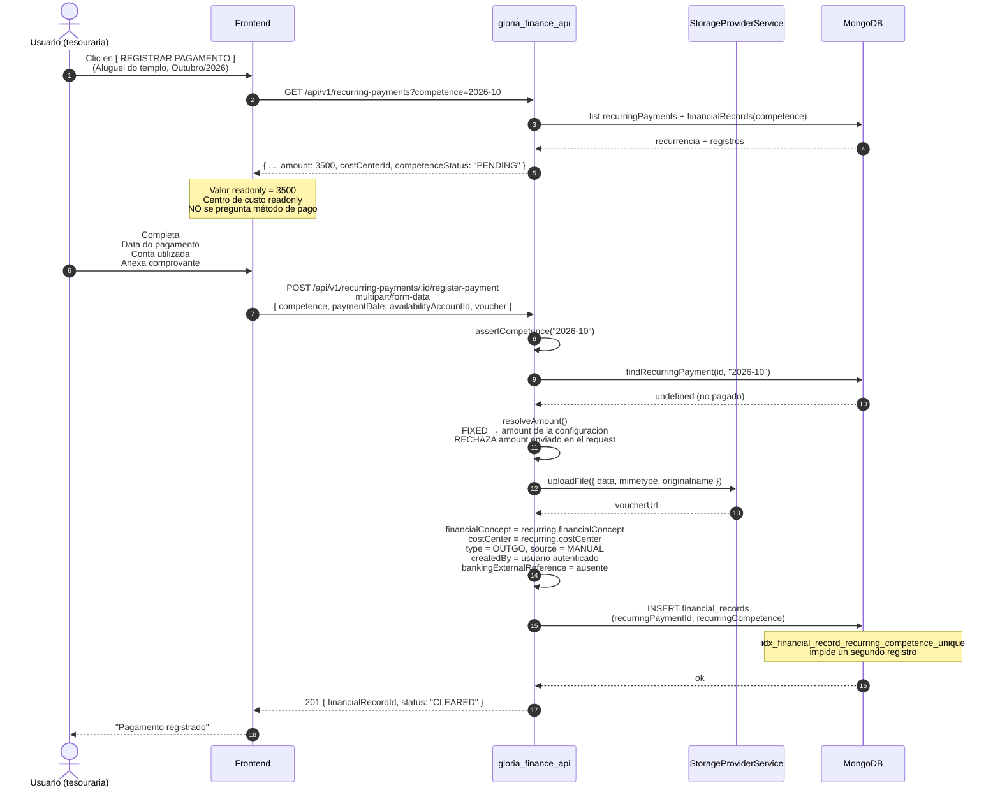

### 2.2 Secuencia 2 — VARIABLE manual

**TARGET**.

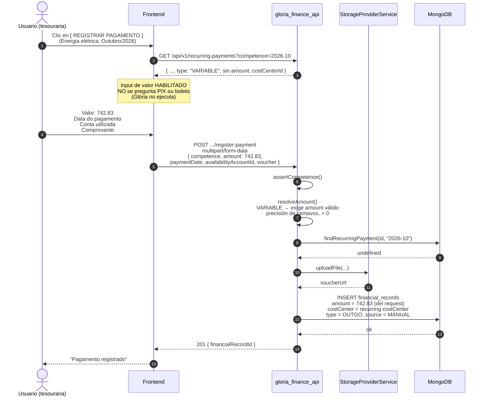

### 2.3 Secuencia 3 — FIXED + saved PIX

**TARGET** (destino en `pixDestination`; `CURRENT` lo tiene en `payment.pixKey` y lo decide por configuración).

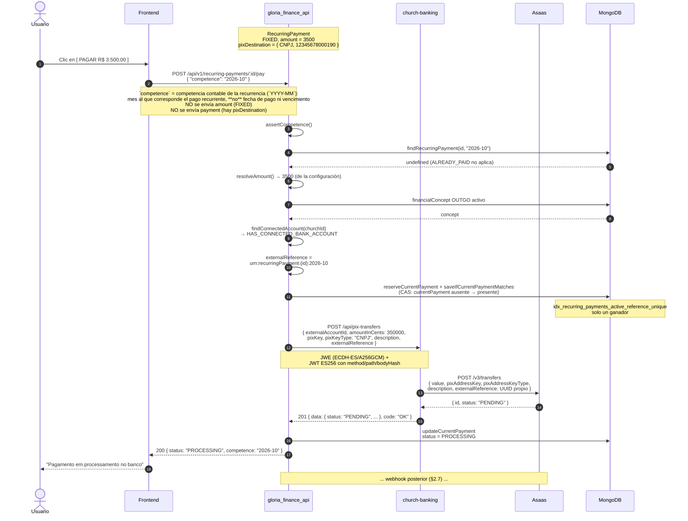

### 2.4 Secuencia 4 — FIXED + PIX informado

**TARGET** (bloqueado hoy: el validator no acepta `pixKey` en la ejecución — GAP-04).

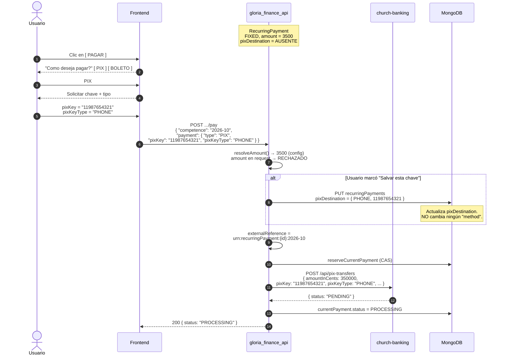

### 2.5 Secuencia 5 — VARIABLE + PIX

**TARGET**.

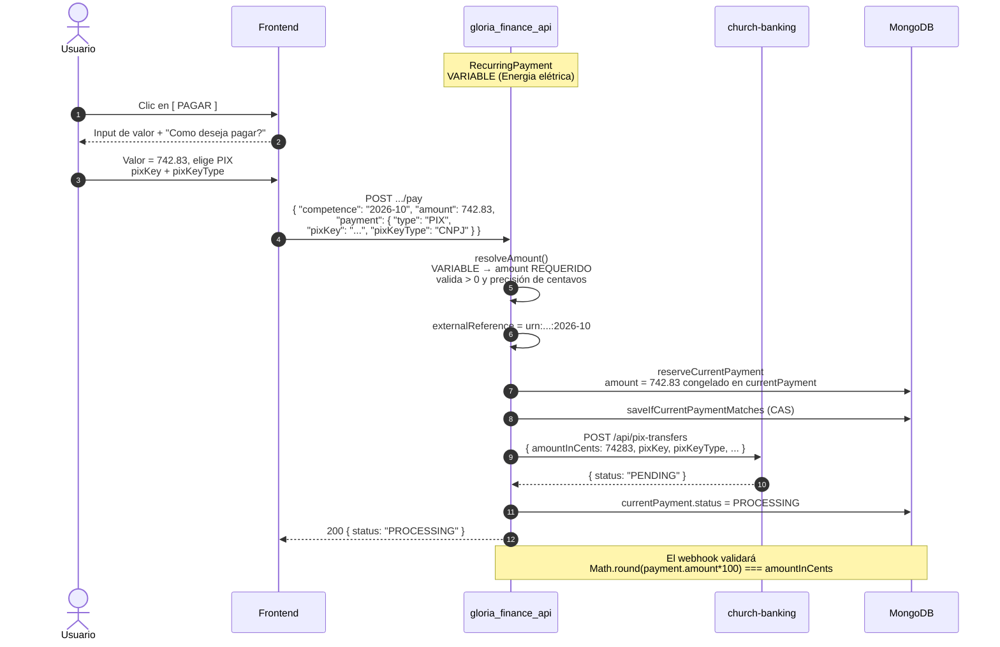

### 2.6 Secuencia 6 — VARIABLE + BILL

**TARGET.** Incluye el `PENDING` crítico del valor del boleto (§14 del documento principal).

```mermaid
sequenceDiagram
    autonumber
    actor U as Usuario
    participant FE as Frontend
    participant API as gloria_finance_api
    participant CB as church-banking
    participant ASAAS as Asaas
    participant DB as MongoDB

    Note over API: RecurringPayment<br/>VARIABLE (Energia elétrica)

    U->>FE: Clic en [ PAGAR ]
    FE-->>U: Input de valor + "Como deseja pagar?"
    U->>FE: Valor = 742.83, elige BOLETO
    FE-->>U: "Código de barras / linha digitável"<br/>[ ESCANEAR CÓDIGO ]
    U->>FE: identificationField = "34191.79001 01043..."

    FE->>API: POST .../pay<br/>{ "competence": "2026-10", "amount": 742.83,<br/>  "payment": { "type": "BILL",<br/>    "identificationField": "34191..." } }

    API->>API: resolveAmount() → 742.83 (VARIABLE)
    API->>API: externalReference = urn:...:2026-10
    API->>DB: reserveCurrentPayment<br/>amount = 742.83, identificationField congelado
    API->>DB: saveIfCurrentPaymentMatches (CAS)

    API->>CB: POST /api/bill-payments<br/>{ externalAccountId, identificationField,<br/>description, externalReference }
    Note over API,CB: NO se envía value ni dueDate.<br/>church-banking NO los acepta.

    CB->>ASAAS: POST /v3/bill<br/>{ identificationField, description,<br/>externalReference: UUID propio }
    ASAAS-->>CB: { id, status, value, dueDate }
    Note over ASAAS,CB: Asaas DERIVA value y dueDate del boleto
    CB-->>API: { data: { status: "PENDING", ... }, code: "OK" }

    API->>DB: currentPayment.status = PROCESSING
    API-->>FE: 200 { status: "PROCESSING" }

    Note over API,DB: El valueInCents que devuelve church-banking es el<br/>monto autoritativo; el amount local sólo reserva.<br/>Ver §14.
```

### 2.6b Secuencia — simulación del boleto (UX)

**CURRENT.** `POST /api/v1/recurring-payments/:recurringPaymentId/bill/simulate`
es una lectura: no mueve dinero y no escribe nada.

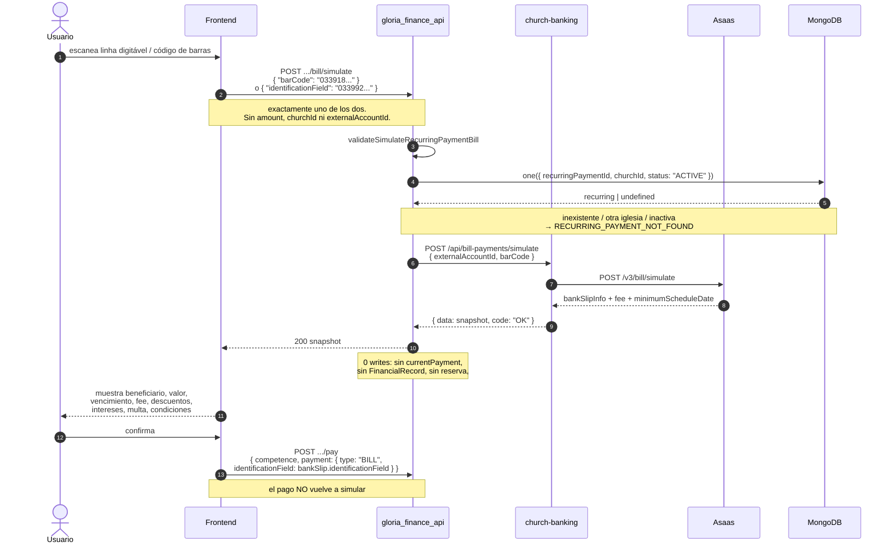

### 2.7 Secuencia 7 — banking webhook success

**CURRENT** (implementado y verificado).

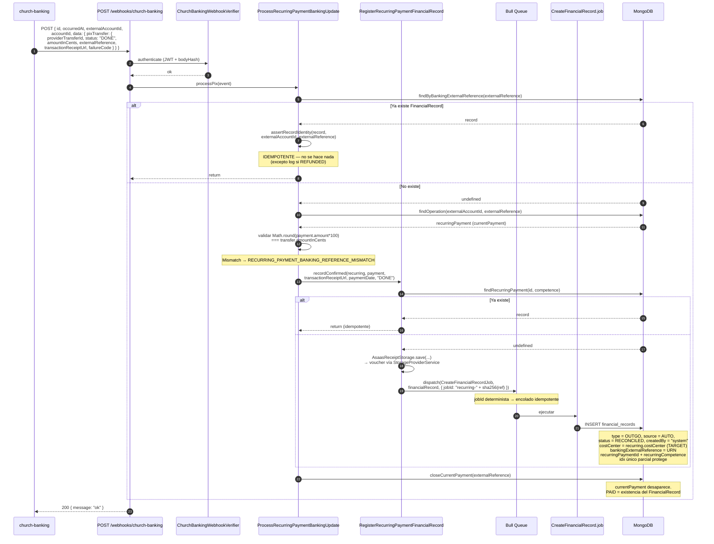

### 2.8 Secuencia 8 — banking failure

**CURRENT**.

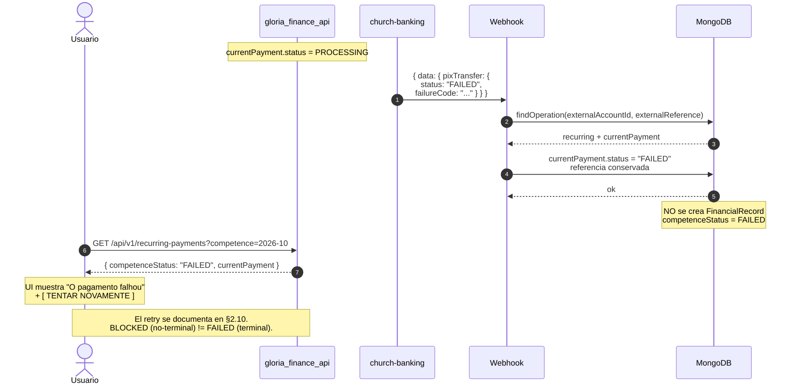

### 2.9 Secuencia 9 — BLOCKED

**CURRENT**. `BLOCKED` **solo existe para PIX**; no es terminal en `church-banking`.

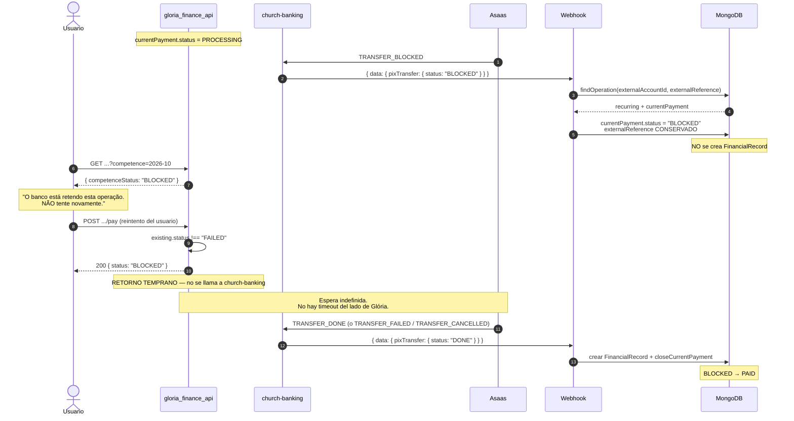

### 2.10 Secuencia 10 — retry

**CURRENT**. Distingue **rechazo confirmado** de **resultado desconocido** — la distinción más importante del sistema.

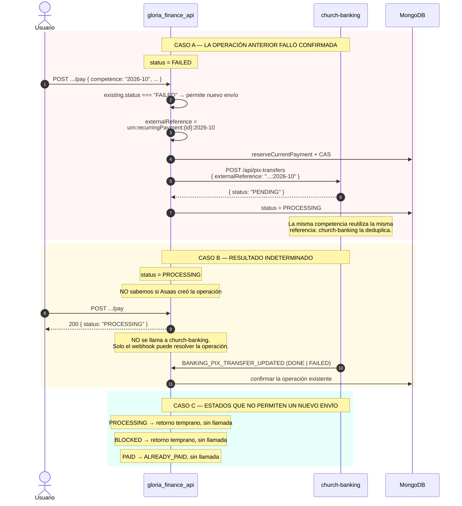

### 2.11 Resumen de las transiciones

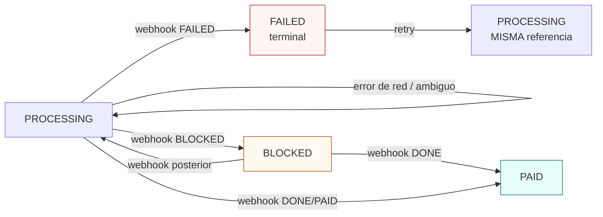

---

## 3. Diagrama de estados

### 3.1 Estado por competencia

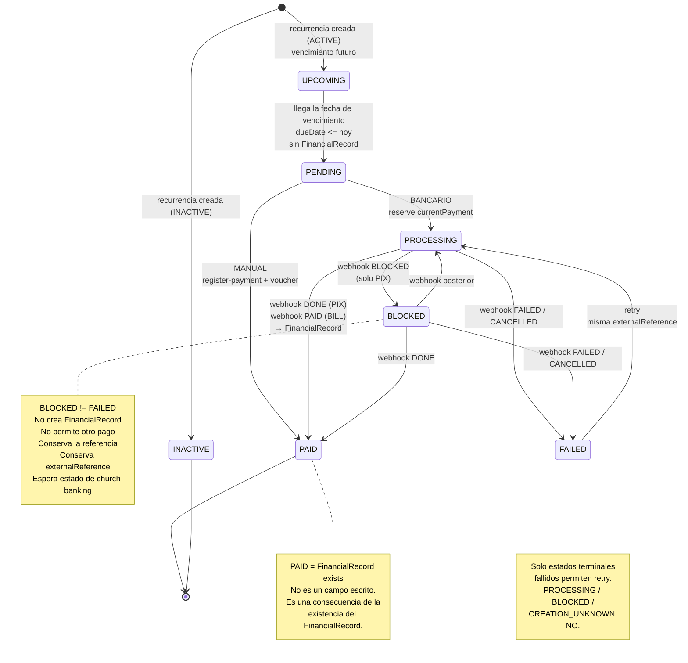

### 3.2 Tabla de precedencia de cálculo

`ListRecurringPayments.competenceStatus` resuelve el estado en este orden exacto (`CURRENT`, verificado):

| # | Condición | Estado resultante |
|---|---|---|
| 1 | `RecurringPayment.status !== "ACTIVE"` | `INACTIVE` |
| 2 | `∃ FinancialRecord(recurringPaymentId, competence)` | `PAID` |
| 3 | `currentPayment.competence === competence` con `status` en `{PROCESSING, BLOCKED, FAILED}` | ese `status` |
| 4 | `dueDateForCompetence(dayOfMonth, competence) <= hoy` | `PENDING` |
| 5 | caso contrario | `UPCOMING` |

**Preservar este orden.** En particular la precedencia de `PAID` sobre `currentPayment`: la evidencia contable manda sobre el estado operativo.

### 3.3 Relación entre el estado de competencia y `currentPayment.status`

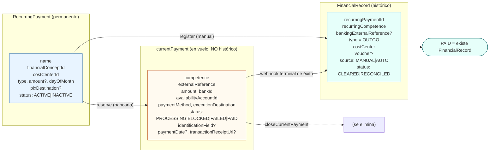

---

## 4. Diagrama de modelo de datos

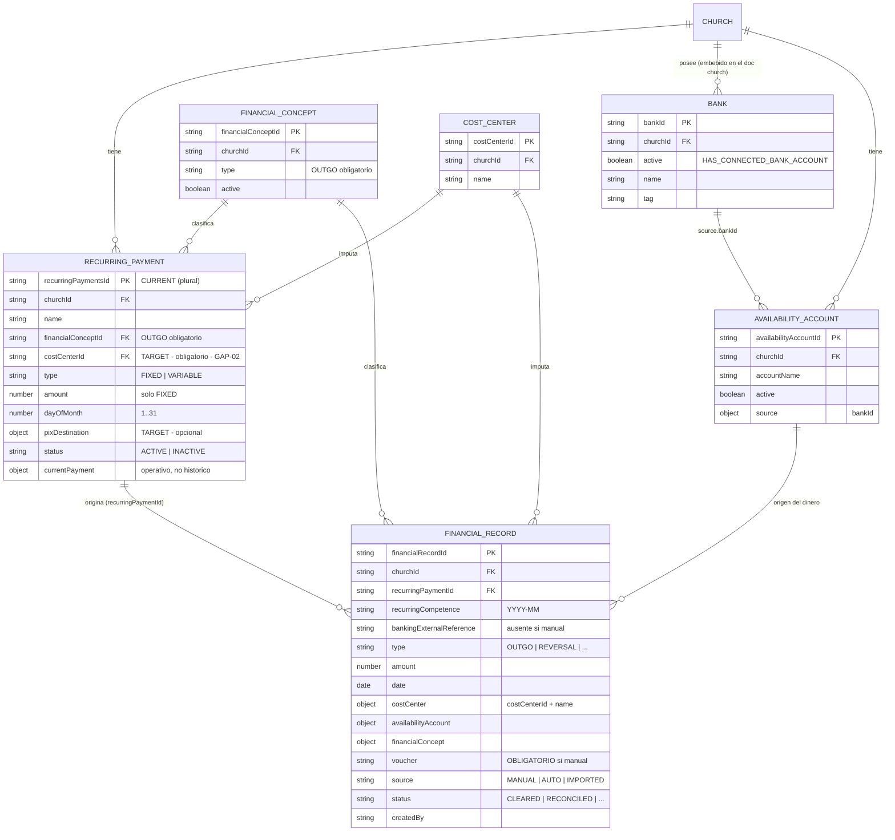

### 4.1 Nota sobre `Bank`

`Bank` **no tiene colección propia**: `static collectionName()` devuelve `"churches"` (`src/Banking/domain/Bank.ts:11-13`). La configuración bancaria de la iglesia vive **dentro del documento de la iglesia**. El `availabilityAccount.source.bankId` apunta al `bankId` de ese objeto embebido.

---

## 5. Diagrama de idempotencia

### 5.1 Las dos capas

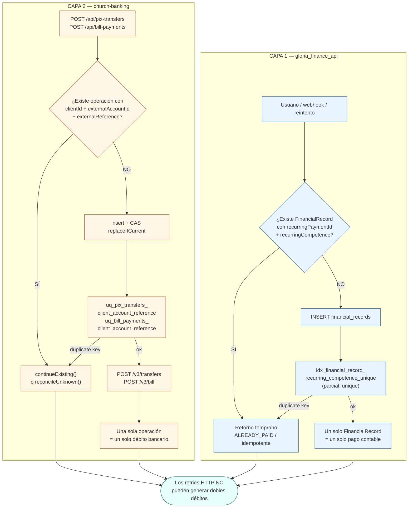

### 5.2 Una referencia estable por competencia

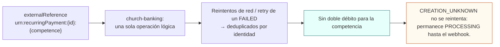

**Esta es la invariante más importante del sistema y debe tener un test explícito.**

### 5.3 Matriz de invariantes

| Invariante | Mecanismo | Ubicación |
|---|---|---|
| Un `FinancialRecord` por recurrencia+competencia | índice único parcial | `FinanceRecordMongoRepository` |
| Una `currentPayment` con referencia activa | índice único sparse | `RecurringPaymentsMongoRepository` |
| Un solo ganador al reservar | CAS `replaceOne` con estado esperado | `saveIfCurrentPaymentMatches` |
| Webhook procesado una vez | cortocircuito por `bankingExternalReference` + `findRecurringPayment` | `ProcessRecurringPaymentBankingUpdate`, `RegisterRecurringPaymentFinancialRecord` |
| Encolado una sola vez | `jobId` determinista = `recurring-` + `sha256(recurringPaymentId:competence:sequence)` | `RegisterRecurringPaymentFinancialRecord` |
| Una operación lógica en el banco | índice único `{clientId, externalAccountId, externalReference}` | `church-banking` |
| Sin nuevo envío tras duda | `CREATION_UNKNOWN` permanece `PROCESSING` | `ExecuteRecurringPayment` |
| Cero registros manuales duplicados | índice único + `findRecurringPayment` (sin `currentPayment`) | §22 del documento principal |
